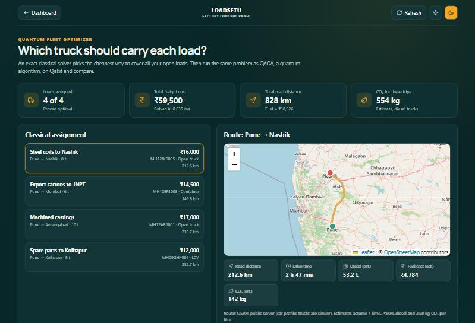
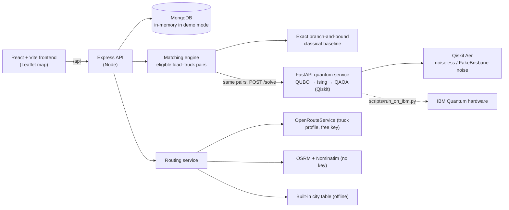

<div align="center">

# LoadSetu · Quantum Fleet Optimizer

**Team OOPs** · **VTU-QFF-HC-0107** · Tier: **Online**
VTU-QFF Hackathon · VTU-Qiskit Fall Fest 2026

Freight matching for Indian factories and transporters, with the load→truck assignment
solved both exactly (classical) and with **QAOA on Qiskit**, side by side.



</div>

---

## Contents

- [Team](#team)
- [Problem](#problem)
- [Solution](#solution)
- [Architecture](#architecture)
- [The quantum part](#the-quantum-part)
- [Results](#results)
- [How to run](#how-to-run)
- [Deploy](#deploy)
- [Project structure](#project-structure)
- [Tech stack](#tech-stack)
- [Limitations](#limitations)
- [Submission checklist](#submission-checklist)
- [License](#license)

---

## Team

| # | Name | GitHub username | Role |
| :-- | :--- | :--- | :--- |
| 1 | Yash Gaikwad | [yash-kitcoek](https://github.com/yash-kitcoek) | Team Lead |
| 2 | Prasanna Padatare | [PixiePewds](https://github.com/PixiePewds) | Developer |
| 3 | Tushar Deshmukh | [Tushar-Deshmukh-0019](https://github.com/Tushar-Deshmukh-0019) | Developer |

---

## Problem

A factory in an MIDC belt has several loads to ship this week. Transporters have trucks of different types and sizes, each with route legs they will run and a quote. Today the factory owner phones brokers, and trucks often run back empty.

Two things are hard:

1. **Eligibility.** Is the truck big enough, the right body type, free on those dates, and actually going that way?
2. **Assignment.** Given all eligible pairs, which truck takes which load so that **every load ships and the total cost is lowest**? No truck can carry two loads, and no load can go on two trucks. This is a combinatorial problem whose search space grows exponentially with the number of loads and trucks.

**Track / Category:** Online · Quantum optimisation · Logistics

## Solution

LoadSetu is a working web app with three roles: **goods owner** (factory), **transporter** and **broker**. Factories post loads, transporters register trucks and route legs, and bookings go through a confirmation workflow with subscriptions.

On top of that sits the **Quantum Fleet Optimizer** (`/factory/optimizer`):

- A rule-based **matching engine** finds every eligible (load, truck) pair, checking capacity, type, dimensions, equipment, route leg and dates, and explains each rejection.
- An **exact classical solver** (branch-and-bound) picks the best assignment.
- The *same* pairs are sent to a **Qiskit QAOA** service, either a noiseless simulator or a simulator with IBM Brisbane's noise model. The page compares the two answers, the circuit cost, and the measurement histogram decoded back into "load → truck".
- A **road route map** for every trip (Leaflet + OpenStreetMap) shows real road distance, drive time, and diesel, fuel-cost and CO₂ estimates. The map also appears when a factory creates a load, so it can see the trip before posting.

---

## Architecture



Routing tries the providers in order. Without a key it uses the free OSRM demo server, and with no network it falls back to a labelled straight-line estimate, so a demo never breaks.

---

## The quantum part

Full walkthrough with every check: [`quantum/notebooks/qaoa_fleet_assignment.ipynb`](quantum/notebooks/qaoa_fleet_assignment.ipynb).

**Variables.** There is one qubit per eligible pair: $x_i = 1$ means "truck of pair $i$ carries load of pair $i$".

**QUBO.** The constraints become penalties:

$$E(x) = \sum_i (c_i - A)\,x_i + P \sum_{i<j\ \text{share a load or truck}} x_i x_j$$

- $c_i$ is the cost divided by the largest cost, so it lies in $[0, 1]$.
- $A = \text{loads} + 1$. The reward for one more assigned load outweighs any cost difference, so the solver assigns as many loads as possible first and minimises cost second.
- $P = 2A$. Picking a clashing pair always raises the energy, so every minimum is a valid assignment.
- Tests check both properties against brute force on 40 random instances (`quantum/tests/test_qubo.py`).

**Ising.** Substituting $x_i = (1 - Z_i)/2$ gives a `SparsePauliOp` of $Z$ and $ZZ$ terms, built in `qlogistics/qubo.py`.

**QAOA.**
- The circuit is `qaoa_ansatz` with $p = 2$ layers. COBYLA trains it from 6 starting points.
- Training uses an exact NumPy statevector of the diagonal Hamiltonian. A test checks that it equals the Qiskit circuit, and it is about 100× faster than re-simulating the circuit at every optimiser step.
- The trained circuit is sampled with 2,048 shots, and the best *valid* sample is the answer.

**Fairness.** Classical and quantum receive the identical candidate list from the same API response, and the service also reports the exact QUBO optimum.

---

## Results

Demo instance (the seeded data: 4 loads from Pune, 5 trucks, **9 eligible pairs → 9 qubits**):

| | Classical (branch-and-bound) | QAOA, noiseless (Aer) | QAOA, IBM Brisbane noise model |
| :--- | :--- | :--- | :--- |
| Loads assigned | 4 / 4 | 4 / 4 | 4 / 4 |
| Total cost | **₹59,500** | **₹59,500** | **₹59,500** |
| Matches optimum | yes (proven) | yes | yes |
| P(measure the optimal bitstring) | — | 2.6% | 1.8% |
| Valid samples (no rule broken) | — | 80.9% | 56.6% |
| Circuit depth (logical → transpiled) | — | 18 → 16 | 18 → 223 |
| Two-qubit gates | — | 24 | 87 |
| Runtime | 0.6 ms | 2.5–6 s | 6–12 s |

Both quantum runs find the true optimum. With noise, routing the circuit onto the heavy-hex layout makes it about 14× deeper, and the share of valid samples drops from 81% to 57%. **There is no quantum speedup at this size, and we do not claim one.** The value is a correct, tested quantum formulation of real freight data, plus an honest measurement of what noise does to it.

Simulator limits: 12 qubits noiseless (≈5 s) and 10 with noise. Bigger instances are trimmed to the cheapest pairs per load, and the UI says so.

---

## How to run

**Prerequisites:** Node.js **20.11+**, Python **3.11+**, Git.

```bash
git clone https://github.com/vtu-qiskit-fall-fest-2026/vtu-hc-oops.git
cd vtu-hc-oops
npm run setup     # installs backend + frontend packages, creates quantum/.venv with requirements.txt
npm run dev       # starts quantum service :8000, API :5000, web app :5173
```

Open **http://localhost:5173**. No database, `.env` or API key is needed. With no `MONGODB_URI` the API starts an in-memory MongoDB and seeds it, so data resets on restart.

### Demo logins (password `Demo@1234`)

| Role (pick on the login form) | Email |
| :--- | :--- |
| Goods owner | `factory@demo.loadsetu.in` |
| Transporter | `transporter1@demo.loadsetu.in`, `transporter2@demo.loadsetu.in` |
| Broker | `broker@demo.loadsetu.in` |

Go to **Factory dashboard → Quantum fleet optimizer**, then press **Run QAOA**. Switch to *IBM Brisbane noise* and run again to compare.

These accounts exist only in the in-memory demo database. `npm run seed` refuses to run with `NODE_ENV=production`.

### Configuration (optional)

Copy `backend/.env.example` to `backend/.env`. Every value is optional for the demo.

| Variable | What it does |
| :--- | :--- |
| `MONGODB_URI`, `JWT_SECRET` | Use a real database (data persists). `npm --prefix backend run seed` loads the demo data into it. |
| `ORS_API_KEY` | **Recommended for maps.** A free [OpenRouteService](https://openrouteservice.org/dev/#/signup) key gives truck (HGV) routing and better geocoding. Without it, the keyless OSRM demo server is used (car profile, fair-use limits). |
| `TRUCK_KM_PER_LITRE`, `DIESEL_RUPEES_PER_LITRE` | Inputs for the fuel and CO₂ estimates (defaults 4 km/L, ₹90/L; CO₂ 2.68 kg per litre of diesel). |
| `QUANTUM_SERVICE_URL` | Where the API finds the QAOA service (default `http://127.0.0.1:8000`). |
| `RAZORPAY_KEY_ID`, `RAZORPAY_KEY_SECRET` | Test keys for the subscription flow. Demo accounts are already subscribed. |

### Run pieces separately

```bash
npm run quantum    # QAOA service only
npm run backend    # API only (nodemon)
npm run frontend   # web app only
npm test           # backend tests (node:test) + quantum tests (pytest)
```

The notebook: `quantum/.venv/Scripts/jupyter lab` (Windows) or `quantum/.venv/bin/jupyter lab` (macOS/Linux), then open `quantum/notebooks/`.

### Real IBM Quantum hardware (optional)

Get an API key at [quantum.cloud.ibm.com](https://quantum.cloud.ibm.com/). The free plan includes 10 minutes of device time per month.

```bash
cd quantum
export IBM_QUANTUM_TOKEN=...          # Windows: set IBM_QUANTUM_TOKEN=...
.venv/bin/python scripts/run_on_ibm.py
```

The script trains on the simulator, samples the demo circuit once on the least busy device, and writes `quantum/results/ibm_hardware_run.json`, which the service serves at `GET /hardware-run`. We had no hardware access while building this, so the script is untested on a real device.

---

## Deploy

Vercel (frontend) → Railway (API) → Hugging Face Space (QAOA service, Docker) → MongoDB Atlas.
Step-by-step guide, with every variable and a troubleshooting table: **[docs/DEPLOY.md](docs/DEPLOY.md)**.

---

## Project structure

```text
vtu-hc-oops/
├── package.json            # root scripts: setup, dev, test
├── scripts/dev.mjs         # starts all three services, no extra dependency
├── requirements.txt        # Python deps for quantum/
├── backend/                # Express + Mongoose API
│   ├── src/services/       # matchingEngine, assignmentOptimizer, quantumClient, routingService
│   ├── src/seed/           # demo accounts, trucks and loads
│   └── tests/              # node:test suites
├── frontend/               # React + Vite app
│   └── src/components/     # FleetOptimizer, RouteMap, dashboards…
├── quantum/
│   ├── qlogistics/         # qubo.py, qaoa.py, service.py (FastAPI), demo.py
│   ├── notebooks/          # qaoa_fleet_assignment.ipynb
│   ├── scripts/run_on_ibm.py
│   └── tests/              # pytest
├── docs/                   # setup guides, AI/optimisation notes, change notes
└── legacy/                 # older single-folder copy, kept for its broker-verification code
```

---

## Tech stack

| Layer | Technology |
| :--- | :--- |
| Quantum | Qiskit 1.4, Qiskit Aer, Qiskit IBM Runtime (FakeBrisbane, SamplerV2), SciPy COBYLA |
| Quantum service | Python 3.11+, FastAPI, Uvicorn |
| Backend | Node.js, Express, Mongoose, JWT, mongodb-memory-server (demo mode) |
| Frontend | React 18, Vite, React Router, Leaflet / react-leaflet, lucide-react |
| Maps | OpenStreetMap tiles, OpenRouteService or OSRM + Nominatim |
| Payments | Razorpay (test mode) |
| Tests | `node:test` (28 tests), pytest (6 tests) |

---

## Limitations

- **No quantum advantage claimed.** At 9 to 12 qubits the classical solver is exact and sub-millisecond. QAOA is here to show a correct formulation and to measure noise.
- **Simulation caps at 12 qubits** (10 noisy). Larger fleets are reduced to a sub-problem, and the UI labels the result.
- **Fuel and CO₂ figures are estimates** from distance and fixed averages. Without an ORS key, OSRM routes use a car profile, so real truck times are longer.
- **Delivery deadlines are not optimised.** The load schema has no verified deadline/ETA pair (see `docs/AI-OPTIMIZATION.md`).
- **The hardware script has not been run on a real device** (no token available to us).

---

## Submission checklist

- [x] `README.md` with problem, solution, architecture and results
- [ ] Team members listed under [Team](#team)
- [x] `requirements.txt` committed; project runs from a clean clone (`npm run setup && npm run dev`)
- [x] Notebook committed with **cleared outputs**
- [x] Demo screenshot in the README
- [ ] Repository **public**, all members added as collaborators
- [ ] Code pushed to `main`
- [ ] Short project summary submitted on the hackathon portal

---

## License

Released under the [MIT License](LICENSE).
